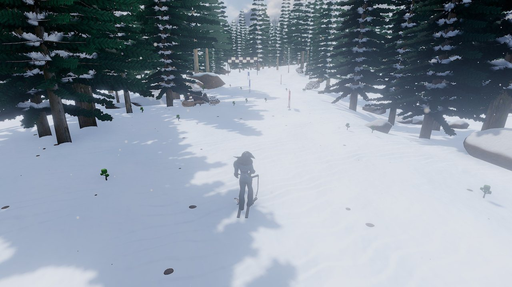
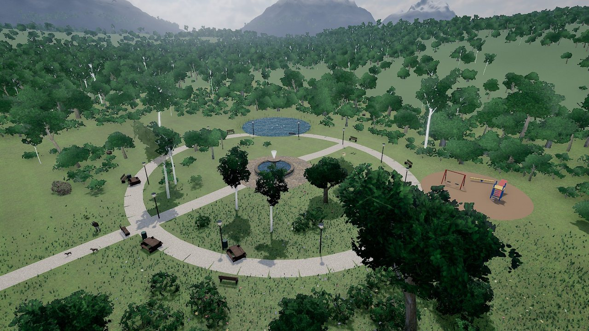
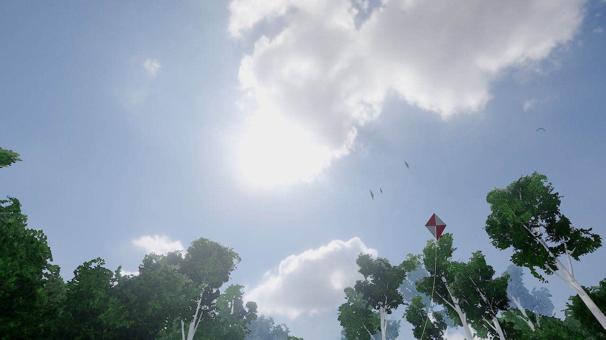

# Gallery

Games and renders from Fantasy Studio, each made locally from a one-line prompt: no diffusion, no cloud, no per-game fee. The games come first; the video renders follow, each with the recipe the dispatcher chose.

Want to contribute a render? Open a PR — see [CONTRIBUTING.md](../CONTRIBUTING.md).

---

## Games (October 2026)

Unedited in-game captures of games built from the sentence under each, HUD hidden.

<table>
<tr>
<td width="50%"> <em>"a tiny ant explores a giant kitchen to carry a sugar cube home"</em></td>
<td width="50%"> <em>"a surfer rides huge waves off a hawaiian beach at sunset"</em></td>
</tr>
<tr>
<td> <em>"a dragon rider flies between floating islands above the clouds"</em></td>
<td> <em>"a hot air balloon pilot floats over cappadocia at sunrise"</em></td>
</tr>
<tr>
<td> <em>"a train driver takes a steam train through snowy mountain passes"</em></td>
<td> <em>"a skier races down a steep black run through the trees"</em></td>
</tr>
<tr>
<td> <em>"a dog fetches a frisbee in a sunny park"</em></td>
<td> <em>"two kids have a snowball fight in a snowy backyard"</em></td>
</tr>
<tr>
<td> <em>"a glowing jellyfish drifts through an underwater cave collecting pearls"</em></td>
<td> <em>"a lighthouse keeper keeps the light burning through a hurricane"</em></td>
</tr>
<tr>
<td> <em>"an astronaut repairs a broken satellite in orbit above the earth"</em></td>
<td> <em>"a giant robot stomps through tokyo at night fighting a sea monster"</em></td>
</tr>
<tr>
<td> <em>"a mars rover drives across red dunes looking for signs of water"</em></td>
<td> <em>"a kid flies a red kite on a windy hill above the sea"</em></td>
</tr>
</table>

### More games

Earlier builds, rebuilt on the October engine and captured the same way.

<table>
<tr>
<td width="50%"> <em>"a tokyo drift racing game through neon streets at night"</em></td>
<td width="50%"> <em>"a samurai walks through a bamboo forest to a mountain shrine as the sun sets over the cherry blossoms"</em></td>
</tr>
<tr>
<td width="50%"> <em>"a gladiator fights three opponents in the colosseum"</em></td>
<td width="50%"> <em>"an explorer reaches the pyramids of giza at sunrise"</em></td>
</tr>
<tr>
<td width="50%"> <em>"a monk climbs a himalayan monastery at dawn"</em></td>
<td width="50%"> <em>"a sheriff hunts three outlaws in a wild west frontier town at high noon"</em></td>
</tr>
<tr>
<td width="50%"> <em>"a kawaii candy land: hop across giant cupcakes and collect 20 sweets"</em></td>
<td width="50%"> <em>"climb a smoking volcano and escape the lava flows"</em></td>
</tr>
<tr>
<td width="50%"> <em>"explore a glowing crystal cave deep underground"</em></td>
<td width="50%"> <em>"a gondolier delivers letters through the canals of venice"</em></td>
</tr>
<tr>
<td width="50%"> <em>"a lighthouse keeper crosses a stormy scottish island at dusk"</em></td>
<td width="50%"> <em>"a knight jousts at a medieval tournament in front of the castle"</em></td>
</tr>
</table>

---

## Cinematic Wildlife

<table>
<tr>
<td width="50%">

**Prompt**: *"a polar bear in the arctic at sunset"* 
**Recipe**: `hero_ocean_horizon` 
**Tier**: Polished

The launch hero shot. Sunset light skating across snow, the bear walking the ridge with the horizon doing all the work. This is what V1 ships to do — single subject, real environment, locally rendered, cinematic.
</td>
<td width="50%">

**Prompt**: *"a horse galloping through mountain pass at golden hour"* 
**Recipe**: `animal_mountain_walk` 
**Tier**: Polished

Golden-hour rim light on a moving subject is one of the harder things to nail with diffusion. With a real renderer it just works — the sun is a sun, the rocks cast real shadows, the gallop cycle reads cleanly at every frame.
</td>
</tr>
<tr>
<td>

**Prompt**: *"a rhinoceros in the desert"* 
**Recipe**: `hero_desert_epic` 
**Tier**: High Quality

The matcher fix from V1.3.7 in action — the alias map now correctly handles `rhinoceros` / `rhinos` / `rhino` as the same subject and refuses to fall through to nearest-tag matches like *elephant*.
</td>
<td>

**Prompt**: *"a deer in the forest at dawn"* 
**Recipe**: `animal_forest_intimate` 
**Tier**: Polished

A quieter shot — soft fill, intimate framing, the camera holding still while the subject does. Counter-programming for the high-energy chase / racing renders.
</td>
</tr>
</table>

---

## Vehicles

<table>
<tr>
<td width="50%">

**Prompt**: *"a ferrari racing at sunset"* 
**Recipe**: `vehicle_desert_hero` 
**Tier**: High Quality

The canary prompt. Cycles, 128 samples, real light bounces, real specular on real paint. The thing diffusion video can't reproduce twice.
</td>
<td width="50%">

**Prompt**: *"a porsche in the desert"* 
**Recipe**: `vehicle_desert_hero` 
**Tier**: Polished

Same recipe, different cast — same scene assembly, same lighting language, different car. The director routes both prompts through the same dispatcher score and gets two coherent shots out the other end.
</td>
</tr>
</table>

---

## Atmospheric / Experimental

<table>
<tr>
<td width="50%">

**Prompt**: *"a cat sitting on a rock in the canyon at golden hour"* 
**Recipe**: `cat_canyon_cinematic` 
**Tier**: Polished

This recipe is named after this exact shot. We hit it once during the V1.3 sprint, said "that's the look," and locked the layer composition. It's now its own dispatcher entry — small subject, big landscape, shallow DOF.
</td>
<td width="50%">

</td>
</tr>
</table>

---

## More renders coming with V1.1

The launch gallery is six shots deep on purpose — every one ran through the public pipeline, every one is a real render Brandon can re-open in Blender. As the launch library expands and the recipe set grows in V1.1, this gallery grows with it.

Submit your own renders via PR. We'll add the best to a community section after launch.

---

## Built in public

For more renders + behind-the-scenes:

- **TikTok**: [@Fantasylab.ai](https://www.tiktok.com/@fantasylab.ai)
- **YouTube**: [@Fantasy_lab_ai](https://youtube.com/@Fantasy_lab_ai)
- **Discord**: Coming soon
- **Waitlist**: [fantasylab.ai](https://fantasylab.ai)
